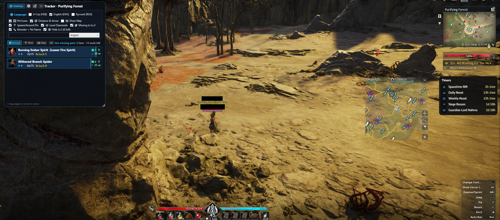

# 🐾 Aion 2 Overlay Hub — Pets & Crafting Tracker


A lightweight, always-on-top, transparent in-game **Overlay Hub for Aion 2** with zero installation required. Tracks your **Pets & Souls progress toward Level 3** and your **⚒️ Crafting & Essence Extraction Goals** in real time directly from your live inventory and nearby spawns.

---

## 📸 In-Game Preview



---

## ✨ Key Features

### 🧩 Modular Overlay Hub
Enable or switch between overlay modules with one click from the top switcher or **`🧩 Overlays`** menu:
- **🐾 Pets & Souls Tracker** — Live progress cards for all pet souls toward Level 3.
- **⚒️ Crafting & Essence Extraction Tracker** — Real-time tracking of herbs, ores, gems, aether, wood, crystals, and alchemy/cooking crafts with live inventory progress and gathering rate.
- **🗺 Zone Spawns Map** — Interactive vector radar map of area boundaries, monster spawn clusters, live nearby monsters, and player position.

### ⚒️ Live Crafting & Essence Extraction Tracker
- **Live Inventory Sync**: Reads item stacks directly from your character inventory in real time.
- **Recipe Decomposition**: Select or pin recipes (e.g. *Major Life Potion*, *Recovery Serum*) and see live progress for all required ingredients.
- **Celebration Banner**: Displays a bright **`🎉 Ready to Craft!`** banner when all required materials are collected.
- **Gathering Speed & ETA**: Calculates collection rate (`+N / hr`) and estimated time remaining based on active gathering session statistics.
- **Node & Area Guide**: Displays the best map and zone for each material, along with required extraction levels (`Req. Lv. 1`–`Lv. 210`).
- **Quick Goals**: Increment or double target quantities (`−10`, `+10`, `×2`, `🗑️`).

### 🔥 Real-Time Level 3 Soul Calculation
- Automatically calculates current Pet Level (`Lv. 0` → `Lv. 3`) and souls within the current tier (`0/5`, `0/25`, `0/75` — `105` total souls for Level 3).
- Displays **`Left: 0 ✔`** once a pet reaches Level 3, or the exact number of souls still needed.
- Location-aware sorting: monsters currently around you and in your zone appear at the top, sorted by proximity (`13 m`, `22 m`, `118 m`...).

### 🚀 Zero Dependency Portable Engine
- Built-in **Pure C# Direct Engine**: Double-clicking `Aion2PetsOverlay.exe` immediately reads `pets-db.json` and syncs with Questlog data in 0 ms. No Node.js or external installations required for end users!
- When Node.js or compatible runtimes are present, background TCP packet synchronization runs seamlessly side-by-side.

### 📍 Location-Aware Filtering
- **Around (`מסביב`)**: Shows pets dropped by monsters currently alive near your character, including live distance (`m`) and count (`×N`).
- **Here / Area (`באזור`)**: Automatically filters pets that spawn inside your current zone polygon.
- **Map (`במפה`)**: Shows all farmable pets in the current world map (`Elysea`, `Asmodae`, `Abyss`, `Altgard`, etc.).
- **All (`הכל`)**: Full searchable catalog of all 209 pets (165 farmable in the world).

### 🗺 Interactive Zone & Spawns Radar Map
- Auto-fits to your current zone or selected pet.
- Displays area polygons with zone names, labeled monster spawn clusters (`Monster Name ×Count`), live nearby monsters, and your player marker.
- Supports **Mouse Drag to Pan**, **Mouse Wheel to Zoom**, **Click on any Pet Card** to highlight & center its spawn points in gold, plus `+` / `−` / `🎯 Reset` / `↕ Height` controls.

### 🖼 Pet Icons & Customizable Checkboxes (`⚙`)
- Automatically downloads and caches official `.webp` pet icons locally in `data/icons/`.
- Toggle every visual element independently via checkboxes:
  - `[✔] Pet Icons`
  - `[✔] Distance & Arrow (m)`
  - `[✔] Show Map`
  - `[✔] Spawn/Around Pin`
  - `[✔] Level Diamonds (◆◆◆)`
  - `[✔] Missing to Lv.3`
  - `[✔] Monster + Pet Name`
  - `[✔] Hide Lv.3 (0 left)`

### 🌐 Multi-Language Support (3 Separate Checkboxes)
- Instant UI & RTL/LTR layout switching between **עברית (`HEB`)**, **English (`ENG`)**, and **Русский (`RUS`)**.

### 📐 Free Window Resize & Click-Through Mode
- Resize freely by dragging any edge or corner (window dimensions & settings persist automatically in `data/ui-settings.json`).
- Global hotkeys for **Click-Through (`F9`)** and **Show/Hide (`F10`)**.

---

## ⌨️ Global Hotkeys

| Hotkey | Action |
| :--- | :--- |
| **`F9`** | Toggle **Click-Through (Lock/Unlock)** mode — passes mouse clicks directly to Aion 2 |
| **`F10`** | Toggle **Show / Hide** overlay window |

---

## 🚀 Quick Start

### Prerequisites
- **Windows 10 / 11** (includes `.NET Framework 4.x` and WPF natively).
- **Node.js** (used by `sniffer.cjs` for background world/polygon indexing and HTTP state serving on `http://127.0.0.1:47420`).
- **Aion 2** running (supports live sync with Questlog `aion-2` state in `%APPDATA%\Questlog\aion-2` and/or raw TCP packet sniffing).

### Running the Overlay
Double-click **`start-overlay.bat`** or launch **`Aion2PetsOverlay.exe`** directly:

```bat
start-overlay.bat
```

You can also view the browser/OBS edition at any time while the backend is running by opening `overlay.html` or `http://127.0.0.1:47420/`.

---

## 🛠️ Building from Source (`Overlay.cs` → `Aion2PetsOverlay.exe`)

No Visual Studio installation is required. Compile `Overlay.cs` directly using the built-in Windows .NET Framework C# compiler (`csc.exe`) in PowerShell:

```powershell
$wpfDir = "C:\Windows\Microsoft.NET\Framework64\v4.0.30319\WPF"
& "C:\Windows\Microsoft.NET\Framework64\v4.0.30319\csc.exe" `
  /nologo /target:winexe `
  /out:"Aion2PetsOverlay.exe" `
  /r:"$wpfDir\PresentationFramework.dll" `
  /r:"$wpfDir\PresentationCore.dll" `
  /r:"$wpfDir\WindowsBase.dll" `
  /r:"C:\Windows\Microsoft.NET\Framework64\v4.0.30319\System.Xaml.dll" `
  /r:"C:\Windows\Microsoft.NET\Framework64\v4.0.30319\System.Web.Extensions.dll" `
  "Overlay.cs"
```

---

## 📁 Project Structure

```text
├── Aion2PetsOverlay.exe   # Compiled native WPF transparent overlay app
├── Overlay.cs             # C# WPF source code (Overlay Hub, Pets Tracker, Interactive Map)
├── sniffer.cjs            # Node.js backend engine (Pets DB indexer, polygon locator, HTTP/file sync)
├── overlay.html           # Browser / OBS web overlay interface
├── start-overlay.bat      # One-click launcher script
├── screenshoot.png        # In-game overlay preview screenshot
└── data/
    ├── pets-db.json       # Complete Aion 2 Pets, Monsters, Worlds, Area Polygons & Spawn points DB
    ├── icons/             # Auto-cached pet icons (.webp) [ignored in git]
    ├── overlay-state.json # Runtime live state snapshot [ignored in git]
    └── ui-settings.json   # Saved user preferences & window size [ignored in git]
```

---

## 🇮🇱 מדריך מהיר בעברית

**Aion 2 Overlay Hub** הוא תוסף שקוף וקל משקל שיושב מעל המשחק Aion 2 ללא צורך בהתקנה, ומציג בזמן אמת:
1. **🐾 מעקב חיות ונשמות (Pets & Souls Tracker)** — התקדמות לרמה 3, מרחק וכיוון מפלצות סביבך.
2. **⚒️ מעקב קראפטינג ואיסוף (Crafting & Essence Extraction)** — מעקב חי אחרי איסוף צמחים, עפרות, אבני חן, את'ר, עץ, קריסטלים ומתכוני שיקויים עם מונה חי מתוך ה-Inventory, קצב איסוף לשעה (Rate/hr), זמן משוער לסיום (ETA), והתראה כשהכל מוכן לייצור (`🎉 Ready to Craft!`).
3. **🗺 מפת אזור וספאונים (Interactive Radar Map)** — מפה וקטורית חיה של נקודות ה-Spawn, מפלצות סביבך וגבולות אזורים.

### תכונות עיקריות
- **עובד עצמאית וללא התקנות (Zero Setup)**: התוכנה מכילה מנוע C# ישיר שקורא מיד את בסיס הנתונים ומתעדכן בזמן אמת — חבר שמוריד מגיטהאב רק לוחץ פעמיים על `Aion2PetsOverlay.exe` וזה עובד מיד!
- **מעקב קראפטינג ואיסוף חי**: סופר בזמן אמת כמה חומרים יש בתיק מול היעד שבחרת, כולל פירוק מתכונים למרכיבים שלהם (למשל שיקוי חיים מובחר דורש 2 אנג'ליקה + 1 עפרת טיטניום + 1 קריסטל מים).
- **חישוב אוטומטי לרמה 3**: מציג לכל חיה את הרמה הנוכחית (`Lv. 0` עד `Lv. 3`), כמות הנשמות בשלב הנוכחי (`5` / `25` / `75`), וכמה נשאר עד רמה 3 (`נשאר: 0 ✔` כשהחיה ברמה 3).
- **מיון חכם לפי קרבה**: מפלצות שנמצאות סביבך מופיעות תמיד בראש הרשימה עם מרחק מדויק במטרים וחץ כיוון.
- **התאמה אישית מלאה (`⚙`)**:
  - 3 צ'קבוקסים נפרדים לבחירת שפה: **עברית (`HEB`)**, **אנגלית (`ENG`)**, ו**רוסית (`RUS`)**.
  - צ'קבוקסים להצגה/הסתרה של תמונות, מרחק במטרים, מפה, יהלומי רמה, והסתרת חיות שהגיעו לרמה 3.
  - שינוי גודל חופשי (Resize) מגבולות החלון והפינות.

### הפעלה וקיצורי מקשים
הפעל את הקובץ **`start-overlay.bat`** או לחץ פעמיים על **`Aion2PetsOverlay.exe`**.
- **`F9`** — נעילת/שחרור עכבר (Click-Through) כדי ללחוץ דרך ה-Overlay לתוך המשחק.
- **`F10`** — הצגה/הסתרה מהירה של ה-Overlay.
